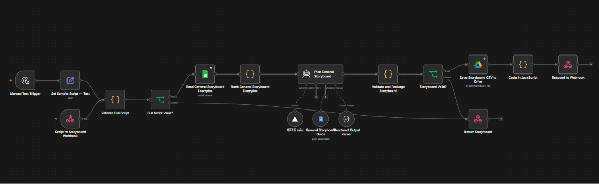

# Storyboard & Background Studio

**Paste a complete script and get a scene-by-scene storyboard.** The app also shows a small gallery of previously generated background examples so people can see the intended kind of environment artwork.

> **Image generation is off in this demo.** The gallery is static. A submitted script creates a storyboard only; it does not request or generate new images.

## What the app does

1. The user pastes the full narration into the web app.
2. The frontend sends it to the dedicated **Script to Storyboard – Public Portfolio** n8n workflow.
3. The workflow consults its general storyboard reference material, asks the text model to plan the scenes, validates the result, and returns the storyboard as CSV data.
4. The UI renders the scenes as a table and lets the user download the CSV.
5. The separate **AI Background Examples** gallery displays three existing, full-frame background samples. These do not change based on the submitted script.

The project uses a storyboard-only workflow. It does **not** call the original image-generation workflow, and it does not include or alter that separate workflow. The n8n workflow stays in the owner’s n8n account; no credential-bearing workflow export is included in this public repository.

## Storyboard columns

The table keeps the seven columns returned by the portfolio planner:

| Column | Purpose |
| --- | --- |
| Scene | Ordered scene number |
| Timecode | Scene timing when available |
| Narration | Script segment for the scene |
| Visual Concept | What the viewer sees in the beat |
| Setting | The environment for the scene |
| Illustration Elements | Characters and drawn elements for the animator |
| Direction Notes | Concise production or transition notes |

## n8n workflow

The app is connected to the storyboard planner workflow named **Script to Storyboard – Public Portfolio**. Its main path validates the script, reads storyboard references, plans and validates the full storyboard, saves the CSV to Drive, and responds to the webhook. There are no image-generation nodes in this workflow.



The workflow screenshot documents the storyboard path only. The separate background-generation workflow belongs to the older private image-generation project and is intentionally outside this demo’s request path.

## Interface

The interface keeps the cartoon-inspired visual treatment while using general project language and examples. The scene table follows the portfolio storyboard planner’s column structure; the background gallery sits below the generator as a separate reference section.

## Tools

| Tool | Use |
| --- | --- |
| HTML, CSS, and JavaScript | Responsive frontend, CSV parsing, storyboard table, and CSV download |
| n8n | Receives the script and orchestrates storyboard planning |
| GPT-5 mini | Drafts scene beats from the complete script and reference material |
| Google Sheets | Supplies the planner’s storyboard examples and guide |
| Google Drive | Stores the storyboard CSV and hosts the static example images |
| Vercel | Hosts the frontend |

## Run locally

This is a static frontend with no package installation step. Serve the repository root with any static file server or connect the repository to Vercel with the project root set to `/` and no build command.

The webhook endpoint is configured near the top of [`app.js`](app.js). Do not put credentials or private n8n workflow exports in the public repository.

## Project files

```text
storyboard-background-studio/
├── app.js
├── favicon.svg
├── index.html
├── styles.css
├── README.md
└── docs/
    └── images/
        └── storyboard-workflow.png
```

## Demo scope

- One full script is planned into a complete storyboard.
- A storyboard CSV can be downloaded from the page.
- Previously generated background examples are shown in a separate gallery.
- Live background generation, Drive delivery of new images, image feedback, and email notifications are not part of this project’s current UI flow.


